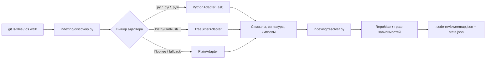
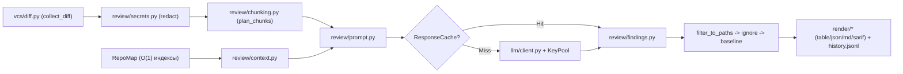

# Архитектура `code-reviewer`

Документ описывает слоистую архитектуру переписанной с чистого листа версии `code-reviewer` (`>= Python 3.12`), потоки данных, формат хранения и ключевые инженерные решения.

## Слои и зависимости

```text
cli/ (Typer-команды, валидация флагов, маппинг AppError -> exit code 2)
  ├── workflows/ (demo, eval, doctor)
  ├── review/    (pipeline, diff context, chunking, prompt, secrets, findings, ignore, history)
  ├── indexing/  (discovery, parsers [ast/treesitter/plain], resolver, builder, graph, summarize)
  ├── render/    (rich console, report table/json/md, sarif 2.1.0, views)
  ├── llm/       (protocol, thread-safe KeyPool, OpenAICompatClient на httpx)
  ├── vcs/       (git CLI wrapper, diff parser/collector, pre-commit hook)
  └── core/      (models, config [pydantic], errors, patterns, atomic storage)
```

- Зависимости направлены строго сверху вниз к `core/`.
- Модули `cli/` не содержат бизнес-логики: они разбирают аргументы, вызывают функции из `indexing/`, `review/` или `workflows/` и передают результат в `render/`.
- Все ошибки доменного уровня наследуются от `AppError` (`core/errors.py`) и перехватываются на границе CLI для аккуратного вывода без трейсбеков.

## Потоки данных

### Проход 1: индексация репозитория (`init`)



### Проход 2: ревью изменений (`check`)



## Форматы хранения в `.code-reviewer/`

| Путь | Назначение |
|---|---|
| `config.toml` | Настройки проекта (валидируются Pydantic, объединяются с `~/.config/code-reviewer/config.toml`) |
| `map.json` | Снимок `RepoMap`: файлы, сигнатуры, docstring, AI-сводки, рёбра графа (`internal` / `external` / `unresolved`) |
| `state.json` | Метаданные: `last_map_at`, `last_map_head`, `last_reviewed_commit`, `last_check_at`, `branch`, `remote_warned` |
| `baseline.json` | Набор стабильных ID зафиксированных замечаний (`--save-baseline` / `--baseline`) |
| `last-review.json` | Находки предыдущего прогона для сверки `--verify` |
| `history.jsonl` | Журнал запусков `check` (по строке JSON на запуск) для расчёта метрик |
| `cache/*.json` | Кэш ответов LLM по `sha256(model, system, user)` |
| `eval-cache/*.json` | Кэш ответов для воспроизводимого прогона `eval` |
| `summary-cache/*.json` | Постоянный кэш AI-сводок по модулям (`init --ai-summary`) |
| `keys.txt` | Список API-ключей (по одному на строку, в `.gitignore`) |

## Ключевые архитектурные улучшения

1. **Индексированный `RepoMap`:** ленивые индексы входящих/исходящих/внешних рёбер (`O(1)` lookup вместо линейного сканирования списка рёбер на каждом шаге BFS).
2. **Потокобезопасный `KeyPool` на `httpx`:** параллельные чанки (`--jobs > 1`) безопасно разделяют один пул ключей под `threading.Lock`, даже когда число чанков превышает число потоков.
3. **Настоящий AST-разбор CommonJS/JS вместо глобальных регулярок:** `TreeSitterAdapter` использует `pack.get_parser()` для обхода узлов `call_expression` (`require("...")`) и функциональных присваиваний (`app.set = function...`), не реагируя на комментарии и строки и не затрагивая другие языки.
4. **Строгий офлайн-режим (`fetch_grammars = false`):** флаг контролирует и prefetch, и пофайловую проверку без сетевых загрузок.
5. **Аккуратное маскирование секретов:** не портит длинные идентификаторы и обращения к свойствам (`password = user.password`), маскируя реальные ключи провайдеров, PEM-блоки, JWT, высокоэнтропийные строковые литералы и строковые значения чувствительных переменных.
6. **Полный анализ inline-директив игнорирования:** `# code-reviewer: ignore` и `# code-reviewer: ignore-file` читаются из полного содержимого проверяемой версии файла (рабочее дерево или `git show <ref>:<path>`), а не только из добавленных `+`-строк diff.
7. **Единый JSON-контракт с LLM:** промпт запрашивает `{"findings": [...]}` в соответствии с `response_format={"type": "json_object"}`, при этом парсер принимает и объект с ключом `findings`, и массив `[...]`, и одиночный объект находки.
8. **Честная фильтрация путей и обновление состояния:** `filter_to_paths` переписывает сокращённый путь на канонический с пересчётом ID; `last_reviewed_commit` не перезаписывается старым `--commit` или упавшей проверкой.
9. **Точный расчёт метрик в `eval` и `history`:** оптимальное сопоставление находок по минимальной дистанции строк, корректный расчёт `precision = 0%` при отсутствии предсказаний на кейсах с дефектами, учёт списка изменённых файлов в `acceptance`.
10. **Автономные `demo` и `eval`:** работают даже без установленного `git` в системе, формируя unified diff через `difflib`.
