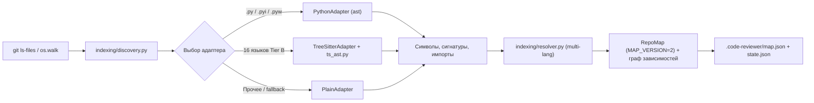
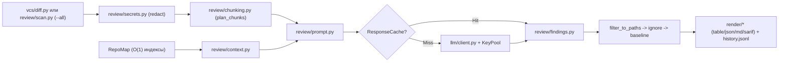

# Архитектура `code-reviewer`

Документ описывает слоистую архитектуру переписанной с чистого листа версии `code-reviewer` (`>= Python 3.12`), потоки данных, формат хранения и ключевые инженерные решения.

## Слои и зависимости

```text
cli/ (Typer-команды: check/scan, keys, map, config, init/status, doctor, ...)
  ├── workflows/ (demo, eval, doctor)
  ├── review/    (pipeline, scan [--all], diff context, chunking, prompt, secrets, findings, ignore, history)
  ├── indexing/  (discovery, parsers [ast/treesitter+ts_ast/plain], resolver, builder, graph, summarize)
  ├── render/    (rich console, report table/json/md/scan_plan, sarif 2.1.0, views)
  ├── llm/       (protocol, thread-safe KeyPool, управлением keys.txt, OpenAICompatClient на httpx)
  ├── vcs/       (git CLI wrapper, diff parser/collector, pre-commit hook с поддержкой frozen-бинарника)
  └── core/      (models [MAP_VERSION=2], config [pydantic], errors, patterns, atomic storage)
```

- Зависимости направлены строго сверху вниз к `core/`.
- Модули `cli/` не содержат бизнес-логики: они разбирают аргументы, вызывают функции из `indexing/`, `review/` или `workflows/` и передают результат в `render/`.
- Все ошибки доменного уровня наследуются от `AppError` (`core/errors.py`) и перехватываются на границе CLI для аккуратного вывода без трейсбеков.

## Потоки данных

### Проход 1: индексация репозитория (`init`)



### Проход 2: ревью изменений (`check` и `check --all`)



## Форматы хранения в `.code-reviewer/`

| Путь | Назначение |
|---|---|
| `config.toml` | Настройки проекта (валидируются Pydantic, объединяются с `~/.config/code-reviewer/config.toml`) |
| `map.json` | Снимок `RepoMap`: файлы, сигнатуры, docstring, AI-сводки, рёбра графа (`internal` / `external` / `unresolved`) |
| `state.json` | Метаданные: `last_map_at`, `last_map_head`, `last_reviewed_commit`, `last_check_at`, `branch`, `remote_warned` |
| `baseline.json` | Набор стабильных ID зафиксированных замечаний (`--save-baseline` / `--baseline`) |
| `last-review.json` | Находки предыдущего прогона для сверки `--verify` |
| `history.jsonl` | Журнал запусков `check` (по строке JSON на запуск) для расчёта метрик |
| `cache/*.json` | Кэш ответов LLM по `sha256(model, system, user)` |
| `eval-cache/*.json` | Кэш ответов для воспроизводимого прогона `eval` |
| `summary-cache/*.json` | Постоянный кэш AI-сводок по модулям (`init --ai-summary`) |
| `keys.txt` | Список API-ключей (по одному на строку, права `0600`, управляется через `keys`, в `.gitignore`) |

## Ключевые архитектурные решения и компоненты

1. **Индексированный `RepoMap` (`MAP_VERSION = 2`):** ленивые индексы входящих/исходящих/внешних рёбер (`O(1)` lookup вместо линейного сканирования на каждом шаге BFS).
2. **Потокобезопасный `KeyPool` и управление ключами (`keys`):** параллельные чанки (`--jobs > 1`) разделяют один пул под `threading.Lock`; `keys add/list/remove/clear` обеспечивают скрытый ввод, права `0600` и маскированный вывод.
3. **Универсальное AST-дополнение поверх `tree-sitter` (`ts_ast.py`) и мульти-языковой `resolver.py`:** поверх `tree-sitter-language-pack` добавлен обход AST для всех 16 языков Tier B (JS/TS/TSX CommonJS, C/C++ `#include` и сигнатуры, Go `struct`/`interface`/receiver, Rust `mod`, очистка `<anonymous>` в Kotlin/Java/Lua/C++, Dart методы/функции, Swift/Scala/PHP/Ruby/C# импорты), а `resolver.py` связывает внутренние модули по `go.mod`, `crate::`, JVM-пакетам, PSR-4, `pubspec.yaml`, C# namespace и `include/`.
4. **Режим полного аудита и защита квоты (`review/scan.py`):** `check --all` строит синтетический diff по карте (исключая не-код и опционально `--no-tests`, фильтруясь через `-p/--path`), с `--dry-run` показывает план чанков/кэша и требует подтверждения при `> 10` некэшированных удалённых запросах.
5. **Упаковка в один бинарник (`scripts/build_binary.py`, `install.sh`, `install.ps1`):** PyInstaller-сборка и установщики под Linux (`/usr/local/bin`), macOS и Windows; `pre-commit` хук умеет определять `sys.frozen`.
6. **Строгий офлайн-режим (`fetch_grammars = false`):** флаг контролирует и prefetch, и пофайловую проверку без сетевых загрузок.
7. **Аккуратное маскирование секретов:** не портит длинные идентификаторы и обращения к свойствам (`password = user.password`), маскируя реальные ключи провайдеров, PEM-блоки, JWT, высокоэнтропийные строковые литералы и строковые значения чувствительных переменных.
8. **Полный анализ inline-директив игнорирования:** `# code-reviewer: ignore` и `# code-reviewer: ignore-file` читаются из полного содержимого проверяемой версии файла (рабочее дерево или `git show <ref>:<path>`), а не только из добавленных `+`-строк diff.
9. **Единый JSON-контракт с LLM:** промпт запрашивает `{"findings": [...]}` в соответствии с `response_format={"type": "json_object"}`, при этом парсер принимает и объект с ключом `findings`, и массив `[...]`, и одиночный объект находки.
10. **Честная фильтрация путей и обновление состояния:** `filter_to_paths` переписывает сокращённый путь на канонический с пересчётом ID; `init` фиксирует первый `HEAD` при наличии коммитов, а `last_reviewed_commit` не перезаписывается старым `--commit`, упавшей проверкой или частичным `--all`.
11. **Точный расчёт метрик в `eval` и `history`:** оптимальное сопоставление находок по минимальной дистанции строк, корректный расчёт `precision = 0%` при отсутствии предсказаний на кейсах с дефектами, учёт списка изменённых файлов в `acceptance`.
12. **Автономные `demo` и `eval`:** работают даже без установленного `git` в системе, формируя unified diff через `difflib`.
