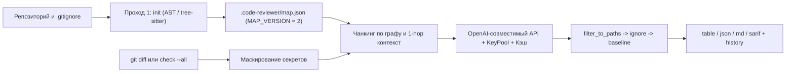

# `code-reviewer` (`cr`)

Локальный AI код-ревьюер, который анализирует `git diff` (или весь репозиторий целиком) в контексте **всей кодовой базы**: карты символов, сигнатур, docstring и графа зависимостей.

В отличие от наивных скриптов, которые отправляют в языковую модель только изолированный патч, `code-reviewer` предварительно строит локальную карту проекта **без единого обращения к LLM** (через AST и `tree-sitter`). Во время ревью модель получает только изменённые участки и компактные сигнатуры реально связанных по графу файлов. Это повышает точность анализа, снижает расход токенов и позволяет комфортно работать даже на бесплатных лимитах API или полностью локально через Ollama / LM Studio.

Обе консольные команды — **`code-reviewer`** и короткий алиас **`cr`** — полностью равнозначны.

---

## Содержание

1. [Как это работает](#как-это-работает)
2. [Поддерживаемые языки и граф зависимостей](#поддерживаемые-языки-и-граф-зависимостей)
3. [Установка и сборка](#установка-и-сборка)
4. [Быстрый старт](#быстрый-старт)
5. [Полный справочник команд CLI](#полный-справочник-команд-cli)
   - [Глобальные опции и сводная таблица команд](#глобальные-опции-и-сводная-таблица-команд)
   - [`init` и `status` — индексация и состояние карты](#init-и-status--индексация-и-состояние-карты)
   - [`check` и `mark-reviewed` — запуск ревью и аудит кода](#check-и-mark-reviewed--запуск-ревью-и-аудит-кода)
   - [`map` — навигация по карте и графу зависимостей](#map--навигация-по-карте-и-графу-зависимостей)
   - [`keys` — управление пулом API-ключей](#keys--управление-пулом-api-ключей)
   - [`config` — просмотр, проверка и генерация конфигурации](#config--просмотр-проверка-и-генерация-конфигурации)
   - [`history` и `cache` — история проверок и кэши](#history-и-cache--история-проверок-и-кэши)
   - [`install-hook` и `doctor` — pre-commit хук и диагностика](#install-hook-и-doctor--pre-commit-хук-и-диагностика)
   - [`demo` и `eval` — офлайн-демонстрация и стенд оценки качества](#demo-и-eval--офлайн-демонстрация-и-стенд-оценки-качества)
6. [Конфигурация (`config.toml`) и провайдеры LLM](#конфигурация-configtoml-и-провайдеры-llm)
7. [Пул API-ключей и автоматическая ротация](#пул-api-ключей-и-автоматическая-ротация)
8. [Подавление шума, baseline и проверка исправлений](#подавление-шума-baseline-и-проверка-исправлений)
9. [Приватность и маскирование секретов](#приватность-и-маскирование-секретов)
10. [Форматы отчётов, коды возврата и интеграция в CI/CD](#форматы-отчётов-коды-возврата-и-интеграция-в-cicd)
11. [Структура каталога `.code-reviewer/`](#структура-каталога-code-reviewer)
12. [Разработка и документация](#разработка-и-документация)

---

## Как это работает

Система работает по **двухпроходной схеме**:

1. **Проход 1 (`init` — локально, без вызовов LLM):**
   - обход репозитория с учётом `.gitignore` и правил `[map].ignore`;
   - извлечение символов (классы, методы, функции, константы), сигнатур, аннотаций, декораторов, docstrings и импортов;
   - разрешение импортов в граф зависимостей и сохранение снимка в `.code-reviewer/map.json` (`MAP_VERSION = 2`);
   - опциональный флаг `--ai-summary` генерирует краткие описания модулей по их сигнатурам и docstring и кэширует их в `.code-reviewer/summary-cache/` (без этого флага `init` никогда не обращается к модели).
2. **Проход 2 (`check` / `check --all` — анализ через LLM):**
   - сбор `git diff` (или построение синтетического diff по всей карте при `--all`);
   - автоматическое маскирование секретов и токенов до отправки в API (`[privacy].redact_secrets`);
   - разбиение большого diff на чанки по связным компонентам графа зависимостей и добавление сигнатур связанных файлов (глубина `[review].context_depth`);
   - кэшированный по `sha256(model, system, user)` вызов OpenAI-совместимого `/chat/completions` через потокобезопасный пул ключей;
   - детерминированная постобработка ответа в строгом порядке:
     `filter_to_paths` (отсев галлюцинаций вне diff, приведение к каноническому пути) → `ignore` (`.code-reviewerignore` и inline-директивы по полному тексту файла) → `baseline`;
   - рендеринг отчёта (`table`, `json`, `md`, `sarif`), сохранение истории в `history.jsonl` и `last-review.json`.



---

## Поддерживаемые языки и граф зависимостей

Парсинг разделён на три уровня (**Tier A**, **Tier B**, **Tier D**):

| Уровень | Языки и расширения | Механизм | Что извлекается |
|---|---|---|---|
| **Tier A** | **Python** (`.py`, `.pyi`, `.pyw`) | `stdlib ast` (`PythonAdapter`), без внешних пакетов | Классы, методы, функции (`async def`, вложенные), константы верхнего уровня, аннотации типов, до 3 декораторов, docstrings, импорты; явная фиксация `SyntaxError` |
| **Tier B** | **JavaScript** (`.js`, `.jsx`, `.mjs`, `.cjs`), **TypeScript** (`.ts`, `.mts`, `.cts`), **TSX** (`.tsx`), **Go** (`.go`), **Rust** (`.rs`), **Java** (`.java`), **Kotlin** (`.kt`, `.kts`), **C#** (`.cs`), **Ruby** (`.rb`), **PHP** (`.php`), **C** (`.c`, `.h`), **C++** (`.cpp`, `.cc`, `.cxx`, `.hpp`, `.hh`), **Scala** (`.scala`), **Swift** (`.swift`), **Lua** (`.lua`), **Dart** (`.dart`) — **16 грамматик** | `tree-sitter-language-pack` + `ts_ast.py` | Символы, сигнатуры, doc-комментарии и импорты с обходом AST под каждый язык (ES-модули и CommonJS, `#include`, Go `struct`/`interface`/receiver, Rust `mod`, очистка `<anonymous>` и др.) |
| **Tier D** | Все остальные языки, конфиги и разметка (`.sh`, `.sql`, `.yaml`, `.toml`, `.md`, `.vue`, `.svelte`, `.zig`, `.ex`, `.proto`, `Dockerfile`, `Makefile` и др.) | `PlainAdapter` (catch-all) | Язык по расширению, число строк (LOC), первый комментарий (fallback при отсутствии грамматики или без `tree-sitter`); в LLM-ревью `git diff` участвуют наравне со всеми языками |

### Особенности карты и графа зависимостей

- **Три статуса рёбер графа:** `internal` (разрешено в файл внутри репозитория), `external` (внешняя библиотека), `unresolved` (не удалось сопоставить с файлом проекта).
- **Мультиязыковое разрешение импортов:** flat- и `src/`-layout в Python, относительные пути `./` и `../`, локальные `#include` (с поиском в `include/` / `inc/` / `src/`), модули Go по `go.mod`, пути Rust (`crate::`, `super::`, `self::`, `mod`), пакеты Java / Kotlin / Scala, PHP (PSR-4), Ruby, Lua, Dart (`pubspec.yaml`) и C# namespace.
- **Исключение `if TYPE_CHECKING:` в Python:** импорты внутри блоков `if TYPE_CHECKING:` намеренно исключаются из графа зависимостей, чтобы не создавать ложных циклических связей.
- **Инкрементальное обновление:** повторный `init` и автоматическое обновление перед `check` перепарсивают только изменённые по размеру и `mtime` файлы (или весь проект при увеличении `MAP_VERSION`).
- **Строгий офлайн-режим:** при `map.fetch_grammars = false` код никогда не скачивает грамматики `tree-sitter` из сети (если локальной грамматики нет, файл безопасно обрабатывается через `PlainAdapter`).

---

## Установка и сборка

### 1. Готовый автономный бинарник (Python не требуется)

Сборки для **Linux (`x86_64`)**, **macOS (`arm64`)** и **Windows (`x86_64`)** публикуются в [GitHub Releases](https://github.com/maks-gargamel/code-reviewer/releases). Установщики автоматически кладут рядом команду `code-reviewer` и алиас `cr`, а также проверяют контрольную сумму `SHA-256`.

#### Linux / macOS (`install.sh`)

```bash
# Установка последнего релиза в /usr/local/bin
curl -fsSL https://raw.githubusercontent.com/maks-gargamel/code-reviewer/main/install.sh | sh

# Удаление установленных бинарников
curl -fsSL https://raw.githubusercontent.com/maks-gargamel/code-reviewer/main/install.sh | sh -s -- --uninstall
```

Поддерживаемые опции `./install.sh`:
- `--version <tag>` — конкретный тег релиза GitHub (например, `v0.1.0`; по умолчанию `latest`);
- `--dir <path>` — каталог установки (по умолчанию `/usr/local/bin` или `$INSTALL_DIR`);
- `--local <path>` — установить локально собранный бинарник без скачивания из интернета;
- `--uninstall` — удалить `code-reviewer` и `cr` из каталога установки;
- `-h`, `--help` — показать справку установщика.

#### Windows (`install.ps1`, PowerShell)

```powershell
# Установка последнего релиза в %LOCALAPPDATA%\Programs\code-reviewer
irm https://raw.githubusercontent.com/maks-gargamel/code-reviewer/main/install.ps1 | iex
```

Поддерживаемые параметры `install.ps1`:
- `-Version <tag>` — тег релиза (по умолчанию `latest`);
- `-InstallDir <path>` — каталог установки (по умолчанию `$env:LOCALAPPDATA\Programs\code-reviewer`);
- `-LocalBinary <path>` — путь к локальному `.exe` вместо скачивания;
- `-Uninstall` — удалить `code-reviewer.exe` и `cr.cmd`.

### 2. Локальная сборка бинарника из исходников

На Linux предварительно установите пакет `binutils` (`sudo apt install -y binutils`).

```bash
uv sync --all-extras
uv run python scripts/build_binary.py --checksum
./install.sh --local dist/code-reviewer
```

### 3. Установка для разработки (`Python >= 3.12`, целевой `3.14`)

**Через `uv` (рекомендуется):**

```bash
uv sync --all-extras   # полная установка: tree-sitter, pytest, ruff, mypy, pyinstaller
# или минимальная установка (Python Tier A + Tier D):
uv sync
```

**Через `pip`:**

```bash
python3 -m venv .venv
source .venv/bin/activate
pip install -e ".[treesitter]"
```

### 4. Автодополнение команд в shell

```bash
code-reviewer --install-completion   # установить completion для текущей оболочки
code-reviewer --show-completion      # вывести скрипт completion для ручной настройки
```

---

## Быстрый старт

```bash
# 1. Проверить весь пайплайн без интернета, API-ключа и даже без git
code-reviewer demo

# 2. Перейти в проект, создать карту репозитория (без обращений к LLM) и проверить статус
cd /path/to/repo
code-reviewer init
code-reviewer status

# 3. Добавить один или несколько API-ключей (скрытый ввод; не сохраняется в истории shell)
code-reviewer keys add -c "gemini"

# 4. Исследовать карту и граф зависимостей
code-reviewer map files --lang python
code-reviewer map outline src/app/service.py
code-reviewer map deps src/app/service.py --depth 2
code-reviewer map cycles
code-reviewer map search MyClass
code-reviewer map export --output graph.dot

# 5. Оценить промпт / план сканирования и токены без запросов к API
code-reviewer check --dry-run
code-reviewer check --all --dry-run

# 6. Запустить реальное ревью
code-reviewer check                                # staged или working tree + untracked
code-reviewer check --last                         # последний коммит
code-reviewer check --since-last                   # все коммиты с последнего проверенного HEAD
code-reviewer check --all --no-tests -p src/       # полный аудит src/ без тестов
code-reviewer check --range HEAD~3..HEAD --format sarif --output review.sarif
```

---

## Полный справочник команд CLI

### Глобальные опции и сводная таблица команд

**Глобальные опции `code-reviewer` (`cr`):**
- `-V`, `--version` — показать версию программы и выйти;
- `-h`, `--help` — показать справку;
- `--install-completion` — установить автодополнение для текущей оболочки;
- `--show-completion` — вывести скрипт автодополнения в `stdout`.

**Общая опция `--root DIR`:** присутствует у всех рабочих команд (кроме `demo`). По умолчанию использует текущую директорию или автоматически находит корень git-репозитория.

| Команда | Назначение | Обращается к LLM? |
|---|---|---|
| `init` | Инициализировать `.code-reviewer/` и построить/обновить карту репозитория | Нет (только с `--ai-summary`) |
| `status` | Показать ветку, `HEAD`, статистику карты, устаревшие файлы и точку последнего ревью | Нет |
| `check` | Проверить diff или весь репозиторий (`--all`) через LLM с учётом карты | Да (кроме `--dry-run` и 100% попадания в кэш) |
| `mark-reviewed` | Зафиксировать текущий `HEAD` как `last_reviewed_commit` без вызова LLM | Нет |
| `map` | Подкоманды анализа карты и графа: `deps`, `files`, `outline`, `cycles`, `search`, `export` | Нет |
| `keys` | Управление пулом API-ключей (`.code-reviewer/keys.txt` + env): `add`, `list`, `remove`, `clear` | Нет |
| `config` | Управление конфигурацией: `show`, `check`, `init` | Нет |
| `history` | Показать журнал прошлых проверок (`history.jsonl`) и агрегированные метрики | Нет |
| `cache` | Показать размер и очистить кэши (`responses`, `eval`, `summaries`) | Нет |
| `install-hook` | Установить или удалить git `pre-commit` хук | Нет |
| `doctor` | Полная диагностика окружения, Git, парсеров, конфига, хука и ключей | Нет |
| `demo` | Продемонстрировать полный цикл ревью офлайн (без сети, API-ключа и git) | Нет |
| `eval` | Прогнать эталонные кейсы (`evals/*.json`) и рассчитать `precision` / `recall` / `F1` | Да (при промахе `eval-cache`) |

---

### `init` и `status` — индексация и состояние карты

#### `code-reviewer init`

```bash
code-reviewer init [--root DIR] [--rebuild] [--ai-summary] [--summary-limit N] [--jobs N]
```

| Опция | По умолчанию | Описание |
|---|---|---|
| `--root DIR` | авто | Корень репозитория |
| `--rebuild` | `false` | Перестроить карту с нуля, игнорируя кэш `map.json` |
| `--ai-summary` | `false` | Сгенерировать краткие AI-сводки модулей по сигнатурам и docstring через LLM |
| `--summary-limit N` | `20` | Максимум запросов к модели при `--ai-summary` |
| `--jobs N` | `1` | Число потоков (`1..32`) при генерации AI-сводок |

**Что делает `init`:**
1. Создаёт шаблон `.code-reviewer/config.toml` (если его ещё нет).
2. Добавляет `.code-reviewer/` в `.gitignore`.
3. Строит или инкрементально обновляет `.code-reviewer/map.json` (если `version != MAP_VERSION`, запускает полную пересборку автоматически).
4. При наличии коммитов в git и пустом `last_reviewed_commit` автоматически фиксирует текущий `HEAD` как точку отсчёта для `check --since-last`.
5. При указании `--ai-summary` запрашивает краткие описания для модулей без сводки, сохраняет их в `.code-reviewer/summary-cache/` и записывает в `map.json`. Без `--ai-summary` ни одного запроса к LLM не выполняется.

#### `code-reviewer status`

```bash
code-reviewer status [--root DIR] [--json]
```

Выводит текущую ветку, `HEAD`, дату последнего ревью и `last_reviewed_commit`, статистику карты (файлы, символы, внутренние рёбра, число AI-сводок, разбивка по языкам) и перечень устаревших файлов, требующих перепарсинга. С флагом `--json` отдаёт структурированный JSON.

---

### `check` и `mark-reviewed` — запуск ревью и аудит кода

#### `code-reviewer check`

```bash
code-reviewer check [--root DIR]
                    [--all [-p|--path PATH]... [--no-tests] [-y|--yes]
                     | --last | --since-last | --commit REF | --range A..B]
                    [--dry-run] [--format table|json|md|sarif] [--output FILE] [--json]
                    [--no-cache] [--no-ignore] [--baseline | --save-baseline] [--verify]
                    [--max-files N] [--max-chunks N] [--jobs N] [--quiet]
```

Перед проверкой `check` автоматически подтягивает инкрементальные изменения в карте репозитория (`refresh_map`).

##### 1. Выбор области проверки (взаимоисключающие режимы)

Нельзя комбинировать больше одного режима одновременно (`--all`, `--last`, `--since-last`, `--commit`, `--range`):

| Режим | Что проверяется |
|---|---|
| *(без флагов)* | Режим `auto`: **staged**-изменения (если индекс не пуст), иначе незакоммиченные правки рабочего дерева (**working tree**) + новые (**untracked**) текстовые файлы до `200 КБ` |
| `--last` | Последний коммит (`HEAD`) |
| `--since-last` | Все изменения от `state.last_reviewed_commit` до `HEAD` |
| `--commit REF` | Указанный коммит (без сдвига `last_reviewed_commit`) |
| `--range A..B` | Диапазон коммитов `A..B` (без сдвига `last_reviewed_commit`) |
| `--all` | Полное сканирование всех кодовых файлов репозитория по карте (`map.json`) |

Во всех режимах diff автоматически пропускаются lock-файлы (`uv.lock`, `package-lock.json`, `poetry.lock`, `pdm.lock`, `Pipfile.lock`, `yarn.lock`, `pnpm-lock.yaml`, `Cargo.lock`, `composer.lock`, `Gemfile.lock`), бинарные расширения и служебные каталоги (`.git`, `.code-reviewer`, `node_modules`, `__pycache__`, `.venv`, `dist`, `build`, `target` и т. д.).

##### 2. Дополнительные опции режима `--all`

Флаги `-p`/`--path` и `--no-tests` работают только в паре с `--all`:

| Опция | Описание |
|---|---|
| `-p`, `--path PATH` | Ограничить сканирование указанными файлами или подкаталогами (опцию можно передавать несколько раз, например `-p src/core -p src/api`) |
| `--no-tests` | Исключить тестовые директории и файлы (`tests/`, `test_*`, `*_test.*`, `conftest.py`, `*.spec.*`, `*Tests.*` и др.) |
| `-y`, `--yes` | Автоматически подтверждать большое число запросов к удалённому API без интерактивного вопроса |

**Особенности `--all`:**
- Без явного `-p/--path` автоматически исключаются некодовые файлы (`markdown`, `rst`, `text`, `json`, `xml`, `ini`, `toml`, `yaml`, `csv`).
- Вместе с `--dry-run` выводит **подробный план сканирования**: общее число файлов и токенов, таблицу по каждому чанку, количество попаданий в кэш, число реальных запросов к API и доступных ключей в пуле.
- Для удалённых провайдеров (не `localhost` / Ollama) при более чем **10 некэшированных запросах** срабатывает защита квоты: в терминале запрашивается подтверждение, а в неинтерактивном запуске требуется явно указать `--yes`, `--max-chunks N`, `--path` или `--no-tests`.

##### 3. Управление лимитами, кэшем, фильтрами, отчётами и baseline

| Опция | По умолчанию | Описание |
|---|---|---|
| `--dry-run` | `false` | Показать собранные `system`/`user` промпты (или план `--all`) и оценку токенов без вызова LLM |
| `--format table\|json\|md\|sarif` | из конфига (`table`) | Формат вывода результата |
| `--json` | `false` | Короткий алиас для `--format json` |
| `--output FILE` | `stdout` | Записать отчёт в указанный файл (при `format = table` в файл записывается Markdown) |
| `--no-cache` | `false` | Игнорировать кэш ответов `.code-reviewer/cache/` |
| `--no-ignore` | `false` | Отключить правила `.code-reviewerignore` и inline-директивы |
| `--baseline` | `false` | Скрыть ранее зафиксированные замечания из `.code-reviewer/baseline.json` (несовместим с `--save-baseline`) |
| `--save-baseline` | `false` | Записать текущие замечания в `.code-reviewer/baseline.json` (при этом проверка завершается с кодом `0`, не падая по `fail_on`) |
| `--verify` | `false` | Сверить текущие находки с прошлым запуском (`.code-reviewer/last-review.json`): что исправлено, что осталось, что появилось |
| `--max-files N` | `60` | Максимум проверяемых файлов (`>= 1`); невлезшие файлы фиксируются в `omitted` |
| `--max-chunks N` | `3` (или число файлов при `--all`) | Максимум чанков/запросов к LLM на одно ревью (`>= 1`); невлезшие чанки попадают в `omitted` |
| `--jobs N` | из конфига (`1`) | Число параллельных потоков (`1..32`) при обработке чанков |
| `--quiet` | `false` | Подавить служебный вывод и не печатать пустые отчёты (режим для git `pre-commit` хука) |

##### Правила постобработки и обновления `last_reviewed_commit`

- **Отсутствие тихого отбрасывания:** всё, что не поместилось в `--max-files` или `--max-chunks`, попадает в список `omitted` и явно выводится и в промпт модели, и в отчёт.
- **Строгий порядок фильтрации:**
  1. `filter_to_paths` — отсеивает галлюцинации по файлам вне проверяемого diff, приводит путь к каноническому и пересчитывает ID;
  2. `ignore` — применяет `.code-reviewerignore` и директивы `code-reviewer: ignore` / `ignore-file`;
  3. `baseline` — при `--baseline` отсекает зафиксированные ранее ID.
- **Стабильный ID находки:** `sha256(f"{file}:{line}:{message}")[:8]`. На нём строятся дедупликация, `baseline`, `--verify` и метрики в `history`.
- **Продвижение `last_reviewed_commit`:** точка последнего ревью обновляется **только** если проверка не провалилась по порогу `fail_on`, есть коммит `HEAD` и запускалась полная область (`auto` / `staged` / `--last` / `--since-last` либо полный `--all` без `--path`, `--no-tests` и без `omitted`).

#### `code-reviewer mark-reviewed`

```bash
code-reviewer mark-reviewed [--root DIR]
```

Вручную помечает текущий `HEAD` как проверенный (`state.last_reviewed_commit`) без вызова LLM (удобно, если коммит уже просмотрен человеком и не должен попадать в следующий `--since-last`).

---

### `map` — навигация по карте и графу зависимостей

Все 6 подкоманд работают **полностью локально** по `.code-reviewer/map.json` без вызова LLM:

```bash
code-reviewer map deps PATH [--depth N] [--root DIR]
code-reviewer map files [--lang LANG] [--limit N] [--root DIR]
code-reviewer map outline PATH [--root DIR]
code-reviewer map cycles [--root DIR]
code-reviewer map search QUERY [--limit N] [--root DIR]
code-reviewer map export [--format dot] [--output FILE] [--focus PATH] [--depth N] [--root DIR]
```

| Подкоманда | Аргументы и опции | Что делает |
|---|---|---|
| `map deps` | `PATH` (или суффикс пути), `--depth N` (`>= 0`, дефолт `1`) | Показывает, от каких внутренних/внешних модулей зависит файл и какие файлы зависят от него, на глубину `N` переходов по графу |
| `map files` | `--lang LANG`, `--limit N` (`>= 1`) | Выводит проиндексированные файлы с фильтром по языку и ограничением количества |
| `map outline` | `PATH` (или суффикс пути) | Печатает структуру файла: классы, методы, функции, сигнатуры с аннотациями, константы и docstring |
| `map cycles` | — | Ищет циклические зависимости (сильно связные компоненты) в графе алгоритмом Косараджу |
| `map search` | `QUERY`, `--limit N` (`>= 1`, дефолт `50`) | Ищет символы по подстроке имени или сигнатуры по всей карте |
| `map export` | `--format dot`, `--output FILE`, `--focus PATH`, `--depth N` (`>= 1`, дефолт `1`) | Экспортирует граф зависимостей (весь или окрестность `--focus`) в формат Graphviz DOT (`dot -Tsvg graph.dot -o graph.svg`) |

---

### `keys` — управление пулом API-ключей

```bash
code-reviewer keys add [KEY] [-c|--comment TEXT] [--stdin] [--root DIR]
code-reviewer keys list [--root DIR] [--json]
code-reviewer keys remove INDEX [--root DIR]
code-reviewer keys clear [--root DIR]
```

| Подкоманда | Описание |
|---|---|
| `keys add` | Добавляет ключ в `.code-reviewer/keys.txt` (без дублей, атомарно с правами `0600`, при нахождении внутри `.code-reviewer/` гарантирует наличие `.code-reviewer/` в `.gitignore`). Без аргумента запрашивает ключ скрытым вводом; `--stdin` читает ключ из стандартного ввода (удобно для пайпов без сохранения в истории shell; одновременно с аргументом `[KEY]` использовать нельзя); `-c`/`--comment` прикрепляет комментарий |
| `keys list` | Показывает ключи из `keys.txt` и переменной окружения **исключительно в маскированном виде** (есть `--json`) |
| `keys remove` | Удаляет ключ из файла по 1-based индексу из `keys list` |
| `keys clear` | Удаляет файл ключей `.code-reviewer/keys.txt` |

---

### `config` — просмотр, проверка и генерация конфигурации

```bash
code-reviewer config show [--root DIR] [--json]
code-reviewer config check [--root DIR]
code-reviewer config init [--root DIR] [--force]
```

| Подкоманда | Описание |
|---|---|
| `config show` | Показывает итоговую объединённую конфигурацию (глобальный TOML + проектный TOML + дефолты) и список источников (`--json` отдаёт дамп в JSON) |
| `config check` | Валидирует TOML-файлы и проверяет, нет ли неизвестных секций или опечаток в ключах; при наличии неизвестных ключей выводит предупреждения и завершается с кодом `1` |
| `config init` | Создаёт шаблон `.code-reviewer/config.toml`; с флагом `--force` перезаписывает существующий файл |

---

### `history` и `cache` — история проверок и кэши

```bash
code-reviewer history [--root DIR] [--limit N] [--json]
code-reviewer cache [--root DIR] [--clean] [--json]
```

- **`history`:** читает `.code-reviewer/history.jsonl`, показывает последние `N` запусков (`--limit 10` по умолчанию; `--limit 0` выводит всю историю) и сводные метрики: среднее число замечаний, повторяемость замечаний между запусками, `acceptance` и распределение по категориям.
- **`cache`:** подсчитывает количество файлов и размер в байтах по трём кэшам (`responses` → `cache/`, `eval` → `eval-cache/`, `summaries` → `summary-cache/`). С флагом `--clean` очищает все три каталога кэша.

---

### `install-hook` и `doctor` — pre-commit хук и диагностика

```bash
code-reviewer install-hook [--root DIR] [--force] [--uninstall]
code-reviewer doctor [--root DIR]
```

- **`install-hook`:** устанавливает git-хук `.git/hooks/pre-commit`, который перед коммитом автоматически запускает `code-reviewer check --quiet` на staged-изменениях (поддерживает и запуск из Python-окружения, и автономный PyInstaller-бинарник).
  - Чужой существующий `pre-commit` без специального маркера **никогда** не перезаписывается и не удаляется без явного `--force`.
  - `--uninstall` удаляет только собственный хук `code-reviewer`.
- **`doctor`:** проверяет готовность окружения и проекта (статусы `OK` / `WARN` / `FAIL`; при любом `FAIL` возвращает код `1`):
  1. версия `Python` (`>= 3.12`);
  2. наличие `Git` и корня git-репозитория;
  3. валидность `config.toml` и отсутствие неизвестных ключей;
  4. наличие `.code-reviewer/` и актуальность карты `map.json`;
  5. установлен ли `tree-sitter-language-pack` и список уже скачанных грамматик;
  6. статус `pre-commit` хука;
  7. наличие записей в `history.jsonl`;
  8. наличие ключей API или локального LLM (сами ключи не выводятся — только количество и источники).

---

### `demo` и `eval` — офлайн-демонстрация и стенд оценки качества

```bash
code-reviewer demo
code-reviewer eval [--root DIR] [--cases DIR] [--tolerance N] [--max-cases N] [--jobs N] [--fail-under F] [--no-cache] [--json]
```

- **`demo`:** выполняет полный цикл ревью на встроенном примере с SQL-инъекцией, используя записанный ответ без сети, без API-ключа и без установленного `git` (через `difflib` формируется синтетический diff).
- **`eval`:** прогоняет набор JSON-сценариев из `./evals` (или `--cases DIR`) через реальный пайплайн ревью (с кэшированием в `.code-reviewer/eval-cache/`) и считает micro-average **`precision`**, **`recall`** и **`F1`**. В репозитории уже включены **22 эталонных кейса**:
  - **14 Python:** `bare_except`, `dict_keyerror`, `eval_usage`, `float_equality`, `hardcoded_password`, `mutable_default`, `mutate_during_iteration`, `mutation_of_argument`, `none_deref`, `off_by_one`, `resource_leak`, `shell_injection`, `sql_injection`, `swallowed_exception`;
  - **5 JavaScript:** `js_inner_html`, `js_loose_equality`, `js_missing_await`, `js_sort_without_comparator`, `missing_return_js`;
  - **3 Go:** `go_defer_in_loop`, `go_nil_map`, `ignored_error_go`.

| Опция `eval` | По умолчанию | Описание |
|---|---|---|
| `--cases DIR` | `./evals` | Каталог с тестовыми `.json` кейсами |
| `--tolerance N` | `2` | Допустимый сдвиг по номеру строки (`>= 0`) |
| `--max-cases N` | все | Ограничить число запускаемых кейсов (`>= 1`) |
| `--jobs N` | из конфига (`1`) | Число потоков (`1..32`) для чанков внутри кейса |
| `--fail-under F` | — | Вернуть код выхода `1`, если итоговый `recall < F` (`0.0..1.0`) |
| `--no-cache` | `false` | Игнорировать `.code-reviewer/eval-cache/` |
| `--json` | `false` | Вывести отчёт `eval` в JSON |

---

## Конфигурация (`config.toml`) и провайдеры LLM

Конфигурация собирается в следующем порядке приоритета (**более поздний источник переопределяет предыдущий**):

1. Встроенные значения по умолчанию;
2. Глобальный файл пользователя: `$XDG_CONFIG_HOME/code-reviewer/config.toml` (или `~/.config/code-reviewer/config.toml`);
3. Конфигурация проекта: `<repo>/.code-reviewer/config.toml`;
4. Флаги командной строки CLI.

### Полный шаблон `.code-reviewer/config.toml`

```toml
[llm]
provider = "openai-compatible"
base_url = "https://generativelanguage.googleapis.com/v1beta/openai"
model = "gemini-3.5-flash"
api_key_file = ".code-reviewer/keys.txt"
api_key_env = "CODE_REVIEWER_API_KEY"
temperature = 0.1
max_tokens = 2048
timeout = 90.0
retries = 3

[review]
strictness = "middle"        # junior | middle | senior
language = "ru"              # ru | en
max_chunk_tokens = 8000      # порог разбиения большого diff на чанки
max_chunks = 3               # максимум LLM-запросов на одно ревью
jobs = 1                     # число параллельных потоков при обработке чанков
max_findings = 12            # максимум замечаний на один чанк
context_depth = 1            # глубина обхода графа зависимостей для контекста

[output]
format = "table"             # table | json | md | sarif
fail_on = "warning"          # never | warning | error

[map]
ignore = []                  # дополнительные шаблоны исключений в стиле .gitignore
max_file_bytes = 1000000     # пропускать файлы крупнее указанного размера
fetch_grammars = true        # дозагружать недостающие грамматики tree-sitter

[privacy]
redact_secrets = true        # маскировать секреты и токены перед отправкой
warn_on_remote = true        # предупреждать при первой отправке кода во внешний API
```

### Справочник всех 23 параметров конфигурации

| Секция и ключ | По умолчанию | Ограничения / допустимые значения |
|---|---|---|
| `llm.provider` | `"openai-compatible"` | Любой OpenAI-совместимый API; `"ollama"` или `"local"` отключают требование ключа |
| `llm.base_url` | `"https://generativelanguage.googleapis.com/v1beta/openai"` | Базовый URL (добавляется `/chat/completions`) |
| `llm.model` | `"gemini-3.5-flash"` | Идентификатор модели у выбранного провайдера |
| `llm.api_key_file` | `".code-reviewer/keys.txt"` | Путь к файлу ключей (пустая строка отключает чтение из файла) |
| `llm.api_key_env` | `"CODE_REVIEWER_API_KEY"` | Имя переменной окружения для ключей |
| `llm.temperature` | `0.1` | `0.0 .. 2.0` |
| `llm.max_tokens` | `2048` | `>= 1` |
| `llm.timeout` | `90.0` | `> 0.0` (секунд на HTTP-запрос) |
| `llm.retries` | `3` | `1 .. 10` (число повторов / попыток) |
| `review.strictness` | `"middle"` | `"junior"` \| `"middle"` \| `"senior"` — определяет чеклист промпта |
| `review.language` | `"ru"` | `"ru"` \| `"en"` — язык формулировки замечаний и промпта |
| `review.max_chunk_tokens` | `8000` | `>= 500` — целевой размер одного чанка в токенах |
| `review.max_chunks` | `3` | `>= 1` — лимит чанков за одно ревью (перекрывается `--max-chunks`) |
| `review.jobs` | `1` | `1 .. 32` — число потоков обработки чанков (перекрывается `--jobs`) |
| `review.max_findings` | `12` | `>= 1` — лимит замечаний от модели на один чанк |
| `review.context_depth` | `1` | `0 .. 5` — глубина обхода графа зависимостей при сборе сигнатур |
| `output.format` | `"table"` | `"table"` \| `"json"` \| `"md"` \| `"sarif"` |
| `output.fail_on` | `"warning"` | `"never"` \| `"warning"` \| `"error"` — порог для кода возврата `1` |
| `map.ignore` | `[]` | Список glob-шаблонов исключений при обходе репозитория |
| `map.max_file_bytes` | `1000000` | `>= 1` — максимальный размер индексируемого файла в байтах |
| `map.fetch_grammars` | `true` | `true` \| `false` (`false` запрещает любое скачивание грамматик из сети) |
| `privacy.redact_secrets` | `true` | `true` \| `false` — автоматическое маскирование секретов |
| `privacy.warn_on_remote` | `true` | `true` \| `false` — разовое предупреждение перед первой отправкой во внешний API |

### Уровни строгости и классификация замечаний

- **Режимы `review.strictness`:**
  - `junior` — явные дефекты (необработанные исключения, неверные условия, `None`/null, забытые `return`, незакрытые ресурсы, несоответствие типов);
  - `middle` — логические ошибки, обработка ошибок, нарушения контрактов между модулями, побочные эффекты, ресурсы, безопасность, граничные случаи;
  - `senior` — всё вышеперечисленное плюс инварианты, конкурентность, обратная совместимость публичного API и отсутствие тестов на новое поведение.
- **Уровни серьёзности (`severity`):** `error` (ломает поведение или безопасность), `warning` (вероятный дефект), `info` (важное замечание).
- **Категории (`category`):** `bug`, `logic`, `security`, `performance`, `api-contract`, `error-handling`, `tests`, `maintainability`.

### Примеры настройки популярных провайдеров

<details>
<summary>OpenAI, DeepSeek, Groq, OpenRouter и локальные Ollama / LM Studio</summary>

**OpenAI:**
```toml
[llm]
base_url = "https://api.openai.com/v1"
model = "gpt-4o-mini"
```

**DeepSeek:**
```toml
[llm]
base_url = "https://api.deepseek.com/v1"
model = "deepseek-chat"
```

**Groq:**
```toml
[llm]
base_url = "https://api.groq.com/openai/v1"
model = "llama-3.3-70b-versatile"
```

**OpenRouter:**
```toml
[llm]
base_url = "https://openrouter.ai/api/v1"
model = "google/gemini-2.5-flash"
```

**Ollama (локально, API-ключ не нужен):**
```toml
[llm]
provider = "ollama"
base_url = "http://localhost:11434/v1"
model = "qwen2.5-coder:14b"
```

**LM Studio (локально, API-ключ не нужен):**
```toml
[llm]
base_url = "http://127.0.0.1:1234/v1"
model = "local-model"
```

</details>

---

## Пул API-ключей и автоматическая ротация

Ключи можно задавать любым из способов (или совмещать оба):

1. **Командой `code-reviewer keys add`** — сохраняет в `.code-reviewer/keys.txt` с правами `0600` (на POSIX) и автоматически добавляет `.code-reviewer/` в `.gitignore`.
2. **Вручную в `.code-reviewer/keys.txt`** — по одному ключу на строку; строки с `#` считаются комментариями, также поддерживаются комментарии в конце строки через пробел и решётку:
   ```text
   # Ключи API (по одному на строку; строки с # игнорируются)
   AIza...ключ_1 # основной аккаунт
   AIza...ключ_2 # запасной
   ```
3. **Через переменную окружения** (по умолчанию `CODE_REVIEWER_API_KEY`) — можно передать один ключ или сразу несколько через запятую или пробел.

### Как работает `KeyPool`

- При `401`, `403`, `429`, `5xx` (а также `400` с ошибкой ключа) потокобезопасный `KeyPool` (защищённый `threading.Lock`) автоматически помечает проблемный ключ и переключается на следующий рабочий ключ, не ротируя ключ при геоблокировке региона.
- Для локальных провайдеров (`provider = "ollama"` / `"local"` или хост `localhost` / `127.0.0.1` / `::1`) ключи вообще не требуются.
- **Безопасность:** исходные значения ключей никогда не выводятся в `stdout`, `stderr`, JSON, логи или `doctor`.

---

## Подавление шума, baseline и проверка исправлений

### 1. Файл `.code-reviewerignore`

В корне репозитория можно завести `.code-reviewerignore` со списком glob-шаблонов (строки `#` — комментарии):

```gitignore
# Игнорировать сгенерированный код и старые миграции
src/generated/**
migrations/*.py
```

### 2. Inline-директивы в коде

Пайплайн проверяет директивы **по полному содержимому проверяемой версии файла** (рабочее дерево или `git show <ref>:<path>`), а не только по добавленным строкам патча:

- `code-reviewer: ignore` — подавляет замечания на **текущей** и **следующей** строке;
- `code-reviewer: ignore-file` — отключает все замечания по этому файлу целиком.

Примеры:

```python
# code-reviewer: ignore
cursor.execute(query)  # подавит замечания и на комментарии, и на следующей строке

risky_call()  # code-reviewer: ignore
```

```javascript
// code-reviewer: ignore-file
```

Чтобы временно увидеть все замечания без учёта ignore-правил, запустите `code-reviewer check --no-ignore`.

### 3. Baseline и сверка `--verify`

- **`--save-baseline`:** сохраняет ID текущих замечаний в `.code-reviewer/baseline.json` (не проваливая сборку по `fail_on`).
- **`--baseline`:** скрывает замечания, уже зафиксированные в `baseline.json`, показывая только **новые** дефекты.
- **`--verify`:** сравнивает текущий прогон с `.code-reviewer/last-review.json` и выводит три группы: сколько прошлых замечаний **исправлено**, сколько **осталось** и сколько появилось **новых**.

---

## Приватность и маскирование секретов

Перед отправкой любого фрагмента во внешнюю модель (`privacy.redact_secrets = true`) модуль маскирования (`redact`) заменяет найденные секреты на `<REDACTED_SECRET>`:

1. Блоки приватных PEM-ключей (`-----BEGIN ... PRIVATE KEY----- ... -----END ... PRIVATE KEY-----`).
2. Известные префиксы токенов и ключей: OpenAI/Anthropic (`sk-...`, `sk-proj-...`, `sk-ant-...`), GitHub (`ghp_`, `gho_`, `ghu_`, `ghs_`, `ghr_`), GitLab (`glpat-...`), Google (`AIza...`), AWS (`AKIA...`), Slack (`xox[baprs]-...`), JWT-токены (`eyJ...`).
3. Строковые присваивания чувствительным полям (`api_key`, `apikey`, `secret`, `password`, `passwd`, `token`, `access_key`) без порчи обычного кода вроде `password = user.password`.
4. Высокоэнтропийные строковые литералы в кавычках (длина `>= 32`, `>= 3` классов символов, энтропия Шеннона `>= 4.2`, не являющиеся путями/URL/чистым hex).

При первом обращении к удалённому API (`privacy.warn_on_remote = true`) в `stderr` выводится однократное уведомление о передаче diff во внешний endpoint и его автоматическом маскировании.

---

## Форматы отчётов, коды возврата и интеграция в CI/CD

### Форматы вывода `--format`

- **`table`** — интерактивный вывод в терминал с помощью `rich` (панель сводки, сгруппированные замечания с цветовыми статусами, контекстом и советами по исправлению; весь пользовательский текст безопасно экранируется от Rich-инъекций).
- **`json`** — машиночитаемый массив/структура с ID, файлом, строкой, `severity`, `category`, сообщением и рекомендацией.
- **`md`** — Markdown-отчёт (удобен для комментариев к Pull Request / Merge Request или сохранения через `--output review.md`).
- **`sarif`** — стандарт **SARIF 2.1.0** с `partialFingerprints`, совместимый с вкладкой **Security / Code scanning** на GitHub.

### Коды возврата CLI

| Код | Значение |
|---|---|
| `0` | Успех или все замечания ниже порога `output.fail_on` (также при `--save-baseline`) |
| `1` | Найдены замечания `>= output.fail_on`, `eval` показал `recall < --fail-under`, `config check` нашёл неизвестные ключи или `doctor` выявил `FAIL` |
| `2` | Ошибка аргументов CLI, невалидного TOML/конфига, `git`, отсутствующей карты (`init` не выполнен) или ошибка LLM API |

### Автоматическая проверка перед коммитом (`pre-commit`)

```bash
code-reviewer init
code-reviewer install-hook
```

Теперь при каждом `git commit` будет автоматически выполняться `check --quiet` на staged-изменениях и блокировать коммит при появлении замечаний уровня `>= output.fail_on`.

### Пример для GitHub Actions (SARIF 2.1.0)

```yaml
- name: Run code-reviewer
  env:
    CODE_REVIEWER_API_KEY: ${{ secrets.CODE_REVIEWER_API_KEY }}
  run: |
    code-reviewer init
    code-reviewer check --range ${{ github.event.pull_request.base.sha }}..HEAD \
      --format sarif --output review.sarif
```

---

## Структура каталога `.code-reviewer/`

Каталог `.code-reviewer/` автоматически добавляется в `.gitignore` и хранит все локальные данные инструмента:

| Путь | Назначение |
|---|---|
| `config.toml` | Настройки проекта (объединяются с `~/.config/code-reviewer/config.toml`) |
| `map.json` | Снимок карты репозитория (`RepoMap`, `MAP_VERSION = 2`: файлы, символы, сигнатуры, AI-сводки, граф) |
| `state.json` | Служебное состояние: `last_map_at`, `last_map_head`, `last_reviewed_commit`, `last_check_at`, `branch`, `remote_warned` |
| `baseline.json` | Зафиксированные стабильные ID замечаний (`--save-baseline` / `--baseline`) |
| `last-review.json` | Результаты последнего запуска для сверки `--verify` |
| `history.jsonl` | Построчный журнал всех запусков `check` (источник метрик для команды `history`) |
| `keys.txt` | Список API-ключей (права `0600`, управляется через `keys`) |
| `cache/` | Кэш ответов LLM по детерминированному ключу `sha256(model, system, user)` |
| `eval-cache/` | Отдельный кэш ответов для воспроизводимых прогонов `eval` |
| `summary-cache/` | Кэш AI-сводок модулей, сгенерированных при `init --ai-summary` |

---

## Разработка и документация

### Проверки качества кода и тесты

```bash
uv sync --all-extras
uv run ruff check src tests scripts
uv run mypy src
uv run pytest
uv run code-reviewer demo
uv run code-reviewer eval --fail-under 0.8
```

### Дополнительная документация

- [`docs/CLI.md`](docs/CLI.md) — компактная шпаргалка по командам и флагам CLI
- [`ARCHITECTURE.md`](ARCHITECTURE.md) — слоистая архитектура, диаграммы потоков данных и форматы хранения
- [`SPEC.md`](SPEC.md) — функциональные и нефункциональные требования проекта
- [`STATUS.md`](STATUS.md) — текущий статус проекта, проведённые проверки и бэклог
